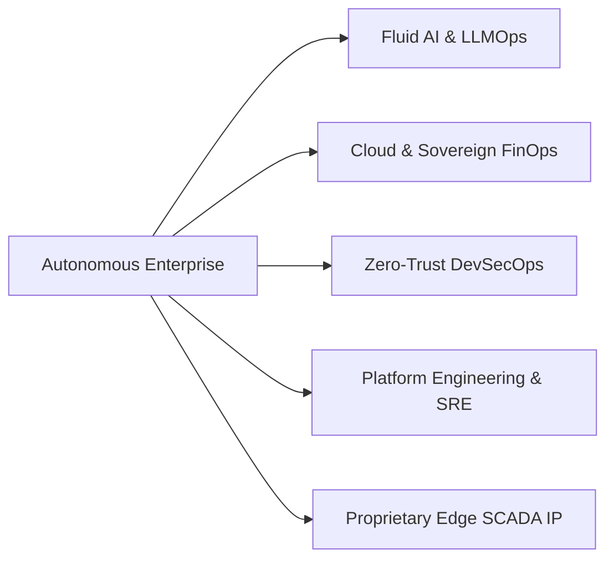

<div align="center">

  <picture>
    <source media="(prefers-color-scheme: dark)" srcset="logo-dark.png">
    <source media="(prefers-color-scheme: light)" srcset="logo-light.png">
    
  </picture>

  <br/><br/>

  # DevOps Insiders
  ### **Engineering the Autonomous Enterprise: AI, Digital Engineering & Cloud Resilience**

  [](https://devopsinsiders.com)
  [](https://www.linkedin.com/company/devopsinsiders)
  [](https://www.youtube.com/@devopsinsiders)
  [](https://whatsapp.com/channel/0029Va8seDZ6GcGFsD7FC11q)
  [](https://nextops.live)

  <br/>

  [](https://devopsinsiders.com)
  [](https://devopsinsiders.com)
  [](https://devopsinsiders.com)
  [](https://devopsinsiders.com)
  [](https://devopsinsiders.com)
  [](https://devopsinsiders.com)

</div>

---

## ⚡ Executive Summary

**DevOps Insiders** is a global Enterprise AI, DevSecOps, and Cloud Modernization powerhouse. Founded by seasoned Principal DevOps architects, we partner with industry leaders across **26+ sectors** — ranging from Tier-1 Wall Street financial institutions to German automotive OEMs and global FMCG conglomerates.

We engineer autonomous agentic operations, modernize complex legacy monoliths into resilient cloud-native platforms, and cultivate elite engineering talent through our flagship **3-Tier Enterprise Academy**.

---

## 🌐 Enterprise Core Practices & Capabilities



### 1. 🤖 Data, Agentic AI Systems & LLMOps (*Fluid Intelligence*)
- **Multi-Agent Orchestration**: Production agentic pipelines using Model Context Protocol (MCP), LangChain, and dynamic reasoning loops.
- **Enterprise Semantic Retrieval**: Low-latency vector database architectures with deterministic guardrails and role-based ACLs.
- **Measurable Value**: Accelerated task automation by **70%** and reduced mean-time-to-resolution (MTTR) by **4.8x**.

### 2. ☁️ Cloud Strategy, Sovereign Infrastructure & FinOps
- **Multi-Cloud Landing Zones**: Production blueprints for AWS, Azure, Google Cloud, and European Sovereign Cloud infrastructure.
- **FinOps Governance**: Unit economics, automated budget enforcement, and resource right-sizing reducing enterprise cloud spend by **up to 38%**.
- **Resilience Engineering**: Chaos engineering protocols, cross-region failover, and strict 99.999% SLA adherence.

### 3. 🛡️ Cybersecurity, Zero Trust & DevSecOps
- **Shift-Left Gating**: Continuous vulnerability scanning, SBOM generation, and cryptographically signed container attestations (Cosign, Sigstore).
- **Zero-Trust Networking**: Mutual TLS (mTLS), SPIFFE/SPIRE workload identities, and micro-segmentation via Cilium eBPF.
- **Compliance Automation**: Automated audit gating for ISO 27001, SOC 2 Type II, HIPAA, and GDPR.

### 4. 🧩 Platform Engineering, Kubernetes & Backstage IDP
- **Internal Developer Platforms (IDP)**: Self-service developer portals powered by Backstage, reducing developer onboarding time to under 1 day.
- **GitOps-Driven Delivery**: Declarative reconciliation pipelines with ArgoCD, Flux, and Kustomize.
- **Cloud-Native Networking**: High-performance eBPF data planes with Cilium and Istio Service Mesh.

---

## 🚀 Proprietary Technology Platforms

Alongside our consulting and transformation practices, DevOps Insiders develops mission-critical proprietary platforms:

| Platform | Domain | Architectural Highlights | Impact |
|:---|:---|:---|:---|
| **[NextOps.live](https://nextops.live)** | Industrial Energy & SCADA | Real-time thermal telemetry, edge Modbus/SCADA ingestion | 250k+ sensor parameters/sec, forced outage prevention |
| **Axion Systems** | Sovereign Industrial IoT | Sub-15ms edge inference, 3D digital twins, SAP PM bridge | Predictive reliability & automated maintenance dispatch |
| **Agentic AI Fabric** | Enterprise Operations | Multi-agent collaboration meshes, MCP toolkits, HITL gates | Automated root cause analysis & self-healing infrastructure |

---

## 🎓 Flagship 3-Tier Enterprise Academy

DevOps Insiders mentors and certifies engineering teams globally, bridging the gap between theoretical cloud concepts and high-velocity production engineering.

```
┌────────────────────────────────────────────────────────────────────────┐
│ LEVEL 3: Business Leaders & Executive Architecture Strategy             │
│ Cloud Governance • Sovereign Cloud • FinOps ROI • Boardroom Risk Mgmt  │
├────────────────────────────────────────────────────────────────────────┤
│ LEVEL 2: Agentic AI Builder (12 Months)                                │
│ Autonomous Agent Meshes • LLMOps • MCP Pipeline Integration • RAG      │
├────────────────────────────────────────────────────────────────────────┤
│ LEVEL 1: Operations Automator (1.5 Years)                              │
│ Linux • CI/CD • Kubernetes • Terraform • SRE • Zero-Trust Foundations  │
└────────────────────────────────────────────────────────────────────────┘
```

* 📘 **Level 1 Course Syllabus**: [`L1_Operations_Automator_Course_DevOps_Insiders.pdf`](./L1_Operations_Automator_Course_DevOps_Insiders.pdf)
* 🧠 **Level 2 Course Syllabus**: [`L2_Agentic_AI_Course_DevOps_Insiders.pdf`](./L2_Agentic_AI_Course_DevOps_Insiders.pdf)
* 🌟 **Live Enrollment & Cohorts**: [devopsinsiders.com/training](https://devopsinsiders.com)

---

## 🛠️ Enterprise Technology Radar & Tooling Matrix

Our architects actively contribute to, evaluate, and operate the modern cloud-native ecosystem:

```
┌───────────────────────────────────────────────────────────────────────────────┐
│                                TECHNOLOGY RADAR                               │
├───────────────────┬───────────────────────────────────────────────────────────┤
│ Cloud & Hyperscale│ AWS • Microsoft Azure • Google Cloud • Sovereign EU Cloud │
├───────────────────┼───────────────────────────────────────────────────────────┤
│ Orchestration     │ Kubernetes (EKS/AKS/GKE) • Docker • Podman • ArgoCD       │
├───────────────────┼───────────────────────────────────────────────────────────┤
│ IaC & GitOps      │ Terraform • OpenTofu • Terragrunt • Ansible • Crossplane  │
├───────────────────┼───────────────────────────────────────────────────────────┤
│ Security & Secrets│ HashiCorp Vault • Trivy • Falco • Cosign • SonarQube      │
├───────────────────┼───────────────────────────────────────────────────────────┤
│ Networking & Mesh │ Cilium (eBPF) • Istio • Envoy • Cloudflare Workers        │
├───────────────────┼───────────────────────────────────────────────────────────┤
│ Observability     │ Prometheus • Grafana • OpenTelemetry • Datadog • Loki     │
├───────────────────┼───────────────────────────────────────────────────────────┤
│ AI & LLMOps       │ LangChain • LlamaIndex • MCP • vLLM • Qdrant • Pinecone   │
└───────────────────┴───────────────────────────────────────────────────────────┘
```

---

## 📊 Global Footprint & Enterprise Trust

```
   [ North America ] ───────── [ Europe ] ───────── [ Asia-Pacific ]
    USA (Enterprise)          UK & Germany              India & Australia
  Cloud Modernization       Sovereign Cloud &         Platform Engineering &
   & FinOps Audits            SCADA NextOps             Academy Headquarters
```

- **Operations**: Across 35+ countries worldwide
- **Enterprise Clientele**: Fortune 500 banks, automotive manufacturers, logistics conglomerates, and tech unicorns.
- **Enterprise Accreditations**: Certified Kubernetes Administrators (CKA/CKAD/CKS), AWS Certified Solutions Architects Professional, Azure Solutions Architects, HashiCorp Certified Terraform Partners.

---

## 🤝 Connect & Collaborate

Whether you are looking to architect an autonomous enterprise, modernise legacy infrastructure, or upskill your engineering teams with battle-tested production curricula:

* 🌐 **Corporate Portal**: [https://devopsinsiders.com](https://devopsinsiders.com)
* 📬 **Direct Inquiries**: [info@devopsinsiders.com](mailto:info@devopsinsiders.com)
* 💼 **LinkedIn**: [linkedin.com/company/devopsinsiders](https://www.linkedin.com/company/devopsinsiders)
* 📺 **YouTube**: [youtube.com/@devopsinsiders](https://www.youtube.com/@devopsinsiders)
* 💬 **WhatsApp Channel**: [Join Official Announcement Channel](https://whatsapp.com/channel/0029Va8seDZ6GcGFsD7FC11q)
* 🏢 **Headquarters**: Tower Astralis, Supernova, Sector-96, Noida, NCR, India (Operating Worldwide)

<br/>

<div align="center">
  <sub>© DevOps Insiders Corporate Network. All rights reserved. Engineering the Autonomous Enterprise.</sub>
</div>
