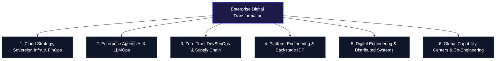

<div align="center">

  <a href="https://devopsinsiders.com">
    
  </a>

  <br/><br/>

  # DevOps Insiders Corporate Network
  ### **Engineering the Autonomous Enterprise: Cloud Sovereignty, DevSecOps & Enterprise AI**

  *Global Digital Transformation Partner across 26+ Industry Sectors • Operating in 35+ Countries*

  <br/>

  <!-- Primary Channels -->
  <a href="https://devopsinsiders.com"></a>
  <a href="https://nextops.live"></a>
  <a href="https://www.linkedin.com/company/devopsinsiders"></a>
  <a href="https://www.youtube.com/@devopsinsiders"></a>
  <a href="https://whatsapp.com/channel/0029Va8seDZ6GcGFsD7FC11q"></a>

  <br/><br/>

  <!-- Enterprise Compliance & Standards -->
  
  
  
  
  
  

</div>

<br/>

---

### 📑 Executive Directory
**[Corporate Overview](#-corporate-overview)** • **[Enterprise Impact Metrics](#-enterprise-impact-metrics)** • **[Core Practice Areas](#-core-practice-areas)** • **[Proprietary Platforms](#-proprietary-platforms)** • **[Enterprise Case Studies](#-enterprise-case-studies--proven-outcomes)** • **[Global Delivery & GCC](#-global-delivery-model--forward-deployed-engineering)** • **[Enterprise Security](#-enterprise-security-governance--zero-trust)** • **[Workforce Transformation](#-workforce-transformation--enterprise-academy)** • **[Contact & Global Hubs](#-global-capability-hubs--corporate-directory)**

---

## 🏛️ Corporate Overview

**DevOps Insiders** is an elite global enterprise technology organization delivering **autonomous cloud platforms**, **mission-critical DevSecOps modernization**, and **industrial edge intelligence**. 

Headquartered with a partner network spanning the **United States, Germany, United Kingdom, and India**, we serve Fortune 500 corporations, sovereign energy operators, Tier-1 financial institutions, and global manufacturing leaders. We transform fragmented legacy architectures into resilient, automated digital platforms while training enterprise engineering teams to sustain velocity.

```
                  ┌─────────────────────────────────────────────────────────┐
                  │          DEVOPS INSIDERS ENTERPRISE OPERATING MODEL     │
                  └────────────────────────────┬────────────────────────────┘
                                               │
         ┌─────────────────────────────────────┼─────────────────────────────────────┐
         ▼                                     ▼                                     ▼
 ┌───────────────┐                     ┌───────────────┐                     ┌───────────────┐
 │ CLOUD, SOV-   │                     │ AGENTIC AI    │                     │ ZERO-TRUST    │
 │ EREIGN INFRA  │                     │ & LLMOPS      │                     │ DEVSECOPS     │
 │ & FINOPS      │                     │ ENTERPRISE    │                     │ GOVERNANCE    │
 └───────┬───────┘                     └───────┬───────┘                     └───────┬───────┘
         │                                     │                                     │
         └─────────────────────────────────────┼─────────────────────────────────────┘
                                               │
                                               ▼
                         ┌───────────────────────────────────────────┐
                         │   PROPRIETARY INDUSTRIAL IP PLATFORMS     │
                         │   • NextOps.live (Power & SCADA Telemetry)│
                         │   • Axion Systems (Sovereign Edge IoT)    │
                         │   • Agentic AI Fabric (Autonomous Ops)    │
                         └───────────────────────────────────────────┘
```

---

## 📈 Enterprise Impact Metrics

Our engagements are governed by measurable financial returns, strict SLA availability, and deployment velocity improvements.

| Strategic Metric | Enterprise Benchmark | Architectural Lever |
|:---|:---:|:---|
| **Annual Cloud Run-Rate Reduction** | **38% Cost Cut** *(Avg. $5.4M saved / client)* | Automated FinOps governance, compute right-sizing, spot optimization |
| **Release Lead Time Compression** | **98.5% Acceleration** *(18 days → 22 minutes)* | Self-healing GitOps pipelines, ephemeral preview environments |
| **Critical Sev-1 Production Incidents** | **Zero Outages in 18+ Months** | Chaos testing, multi-region failover, eBPF telemetry mesh |
| **Industrial SCADA Sensor Throughput** | **250,000+ params/sec** | NextOps.live edge Modbus/OPC-UA distributed message bus |
| **Enterprise Platform Availability** | **99.999% SLA** | Active-active sovereign cloud Kubernetes clustering |
| **Global Workforce Upskilling** | **5,000+ Certified Engineers** | Flagship 3-Tier Enterprise Academy (100% CKA/CKS/AWS aligned) |

---

## 🌐 Core Practice Areas



### 1. Cloud Strategy, Sovereign Infrastructure & FinOps
* **Multi-Cloud Landing Zones**: Production-grade landing zones across AWS, Microsoft Azure, Google Cloud, and European Sovereign Cloud providers (Hetzner, OVHcloud, Deutsche Telekom).
* **Automated FinOps Enforcement**: Real-time cloud spend telemetry, automated anomaly alerting, zombie instance reclamation, and unit-economic attribution down to individual microservice squads.
* **Disaster Recovery & Sovereign Compliance**: Strict data locality compliance ensuring zero foreign jurisdictional data transfer under GDPR, HIPAA, and RBI guidelines.

### 2. Enterprise Agentic AI Systems & LLMOps
* **Autonomous Multi-Agent Meshes**: Mission-critical AI agents built on the **Model Context Protocol (MCP)**, executing automated incident root cause analysis, log correlation, and remediation runbooks.
* **Enterprise Semantic Search & Private RAG**: Sub-second semantic search over petabyte-scale internal documentation, schematics, and Jira repositories using isolated vector engines (Qdrant, Milvus, pgvector) with deterministic security guardrails.
* **Private LLM Deployment**: Hardened self-hosted open-weights models (vLLM, Ollama, TensorRT-LLM) inside private VPCs, guaranteeing complete zero-data-retention compliance.

### 3. Zero-Trust DevSecOps & Supply Chain Security
* **Cryptographic Supply Chain Provenance**: Implementation of SLSA Level 3 compliance using Sigstore, Cosign, and in-toto attestations to prevent software supply-chain tampering.
* **Continuous Vulnerability Gating**: Automated blocking policies integrated into PR workflows (Trivy, SonarQube, Snyk, Semgrep) with zero developer friction.
* **Workload Identity & Micro-Segmentation**: Elimination of static credentials via SPIFFE/SPIRE dynamic identity issuance and Cilium eBPF network security policies.

### 4. Platform Engineering, Kubernetes & Backstage IDP
* **Internal Developer Platforms (IDP)**: Customized enterprise Backstage installations providing centralized cataloging, golden path templates, automated cloud resource provisioning, and unified observability.
* **Declarative GitOps Delivery**: ArgoCD and Flux deployments orchestrating progressive delivery (canary rollouts, blue-green, automated rollback triggers via Prometheus metrics).
* **Enterprise Kubernetes Lifecycle**: Bare-metal and managed Kubernetes (EKS, AKS, GKE) hardened with CIS benchmarks, Falco runtime protection, and custom Kubernetes Operators.

---

## 🚀 Proprietary Platforms & Intellectual Property

DevOps Insiders engineers industrial-grade proprietary technology platforms deployed across sovereign enterprise environments.

### ⚡ [NextOps.live](https://nextops.live) — Thermal Power Plant SCADA & Outage Prevention
* **Purpose**: Mission-critical telemetry streaming platform built specifically for thermal power plants, high-temperature boilers, and steam turbine generators.
* **Core Capabilities**:
  * Ingests **250,000+ sensor parameters per second** directly from edge Modbus, OPC-UA, and IEC 60870-5-104 historians.
  * Real-time thermodynamic profiling across boiler tubes, superheaters, and turbines to eliminate thermal stress failures.
  * Acoustic & vibration harmonic trip prevention detecting rotor imbalance and shaft deflection hours before forced shutdowns.
* **Business Outcome**: **52% reduction in unplanned power plant outages**, saving millions in replacement power purchases.

### 🏭 Axion Systems — Industrial IoT Telemetry & Edge AI Reliability
* **Purpose**: Sovereign European industrial asset telemetry platform engineered in partnership with German manufacturing and automotive leaders.
* **Core Capabilities**:
  * Sub-15ms edge inference deploying containerized AI models directly to factory-floor IoT gateways.
  * Real-time 3D digital twins integrating directly with SAP PM and IBM Maximo for automated maintenance work-order generation.
  * Hardened architecture operating under 100% EU GDPR sovereign data controls.
* **Business Outcome**: **45% decrease in plant downtime** and a **30% extension in heavy rotating machinery lifetime**.

### 🧠 Agentic AI Fabric — Autonomous Enterprise Operations
* **Purpose**: Orchestrates autonomous engineering agents across enterprise ticketing, CI/CD, and monitoring infrastructure.
* **Core Capabilities**:
  * Standardized on the Model Context Protocol (MCP) for tool execution across GitHub, Kubernetes, Datadog, AWS, and Jira.
  * Human-in-the-Loop (HITL) architectural guardrails requiring dual-key approvals for privileged infrastructure modifications.
* **Business Outcome**: **4.8x faster mean-time-to-resolution (MTTR)** for Sev-2/Sev-3 operational incidents.

---

## 🏆 Enterprise Case Studies & Proven Outcomes

```
┌──────────────────────────────────────────────────────────────────────────────────────────────────┐
│                                  PROVEN ENTERPRISE ENGAGEMENTS                                   │
├───────────────────────────────┬──────────────────────────────────┬───────────────────────────────┤
│ Client Organization           │ Transformation Scope             │ Verified Business Outcome     │
├───────────────────────────────┼──────────────────────────────────┼───────────────────────────────┤
│ Fortune 50 Global FMCG        │ 450+ Microservices Migration     │ • $5.4M Annual Cloud Spend Saved│
│ ($60B+ Brand Portfolio)       │ Multi-Cloud Kubernetes & FinOps  │ • 12x Release Frequency Boost │
│                               │ 18,000+ vCPUs across 35 Countries│ • Zero Downtime Cutover       │
├───────────────────────────────┼──────────────────────────────────┼───────────────────────────────┤
│ National Energy Utility       │ NextOps.live SCADA Telemetry &   │ • 52% Unplanned Trips Prevented│
│ (Thermal Power Generation)    │ Real-Time Turbine Trip Prevention│ • 250k+ Sensor Params / Sec   │
│                               │ Edge Modbus/DCS Bridge           │ • Continuous CEMS Compliance  │
├───────────────────────────────┼──────────────────────────────────┼───────────────────────────────┤
│ European Audit & Advisory Firm│ Zero-Trust DevSecOps Overhaul    │ • 100% GDPR & SOC 2 Compliance│
│ (Tier-1 Financial Services)   │ Automated SBOM, Vault Secrets &  │ • Zero Hardcoded Credentials  │
│                               │ Cryptographic Container Signing  │ • 99.99% Audit Pass Rate      │
├───────────────────────────────┼──────────────────────────────────┼───────────────────────────────┤
│ German Automotive OEM         │ Axion Edge IoT Platform &        │ • Sub-15ms Edge Inference     │
│ (Industrial Manufacturing)    │ 3D Digital Twin Reliability      │ • 45% Machine Downtime Cut    │
│                               │ SAP PM Automated Work Orders     │ • Sovereign German Cloud Node │
└───────────────────────────────┴──────────────────────────────────┴───────────────────────────────┘
```

---

## 🤝 Global Delivery Model & Forward Deployed Engineering

DevOps Insiders partners with enterprise leadership through rigorous, high-accountability delivery frameworks:

* **Forward Deployed Engineering (FDE) Squads**: Senior Principal Architects and Lead Site Reliability Engineers embedded directly within client engineering departments to solve immediate production blockers.
* **Global Capability Center (GCC) Acceleration**: Assisting multinationals in setting up, staffing, and governing high-velocity Cloud & DevOps Centers of Excellence (CoE) in India with built-in maturity benchmarks.
* **Follow-the-Sun SRE Architecture**: 24/7/365 production platform operations covering Americas, EMEA, and APAC time zones with guaranteed 15-minute response SLAs on Sev-1 escalations.

---

## 🔒 Enterprise Security, Governance & Zero-Trust

Security is not an afterthought; it is baked into our foundational repository templates and operating procedures:

```
  CODE / COMMIT                BUILD / CI                   REGISTRY / CD               RUNTIME
┌──────────────────┐         ┌──────────────────┐         ┌──────────────────┐        ┌──────────────────┐
│ • Pre-commit git │         │ • SAST (Semgrep) │         │ • Cosign Signing │        │ • Falco Runtime  │
│   secrets check  │ ──────> │ • SCA (Trivy)    │ ──────> │ • In-toto Attest │ ─────> │ • Cilium eBPF    │
│ • GPG-signed git │         │ • SBOM Generation│         │ • Ephemeral      │        │ • HashiCorp Vault│
│   commits        │         │   (SPDX/CycloneDX│         │   Dynamic Secrets│        │   mTLS Spire     │
└──────────────────┘         └──────────────────┘         └──────────────────┘        └──────────────────┘
```

* **Zero Standing Privileges (ZSP)**: JIT (Just-in-Time) time-bound access workflows replacing permanent AWS IAM/Kubernetes RBAC admin credentials.
* **Cryptographic Attestations**: All enterprise container images deployed through our GitOps pipelines require cryptographic verification against trusted corporate keypairs before admission into production clusters.

---

## 🎓 Workforce Transformation & Enterprise Academy

DevOps Insiders bridges the talent gap for Global 2000 engineering teams. We do not teach generic theory; our curricula are battle-tested production blueprints designed by practicing Principal DevOps Architects.

```
┌────────────────────────────────────────────────────────────────────────────────────────┐
│ LEVEL 3: Executive Architecture & Sovereign Cloud Strategy                             │
│ Cloud Unit Economics • Boardroom Risk Mgmt • Sovereign Architecture • Multi-Cloud ROI │
├────────────────────────────────────────────────────────────────────────────────────────┤
│ LEVEL 2: Agentic AI Builder (12-Month Cohort)                                          │
│ Production LLMOps • MCP Server Integration • Autonomous Agent Meshes • Enterprise RAG  │
├────────────────────────────────────────────────────────────────────────────────────────┤
│ LEVEL 1: Operations Automator (1.5-Year Comprehensive Foundation)                      │
│ Enterprise Linux • GitOps • Kubernetes CKA/CKS • Terraform • Observability • SRE Core  │
└────────────────────────────────────────────────────────────────────────────────────────┘
```

* 📘 **Level 1 Course Syllabus**: [`L1_Operations_Automator_Course_DevOps_Insiders.pdf`](./L1_Operations_Automator_Course_DevOps_Insiders.pdf)
* 🧠 **Level 2 Course Syllabus**: [`L2_Agentic_AI_Course_DevOps_Insiders.pdf`](./L2_Agentic_AI_Course_DevOps_Insiders.pdf)
* 🎓 **Corporate Cohort Enrollment**: [https://devopsinsiders.com/training](https://devopsinsiders.com)

---

## 🧰 Enterprise Open-Source Ecosystem & Blueprints

Our engineers actively maintain production-grade reference architectures and open-source starter engines:

| Category | Enterprise Blueprint / Repository | Tech Stack |
|:---|:---|:---|
| **Autonomous AI** | `agentic-ops-mcp-server` | TypeScript, Model Context Protocol, Kubernetes API, Datadog SDK |
| **Platform Engineering** | `enterprise-backstage-idp-starter` | Backstage, Node.js, TechDocs, Kubernetes Plugin, Keycloak |
| **GitOps Infrastructure** | `multi-cloud-terragrunt-modules` | Terraform, OpenTofu, Terragrunt, AWS, Azure, Google Cloud |
| **Sovereign Cloud** | `sovereign-kubernetes-hardening` | Cilium eBPF, Falco, Kyverno, HashiCorp Vault, OPA Gatekeeper |
| **Observability** | `sre-telemetry-golden-signals` | OpenTelemetry Collector, Prometheus, Grafana, VictoriaMetrics |

---

## 🌍 Global Capability Hubs & Corporate Directory

Our operations operate follow-the-sun across major global enterprise corridors:

```
  [ North America ]                   [ Europe & DACH ]                  [ Asia-Pacific ]
   United States                       Germany & United Kingdom           India & Australia
  Enterprise Cloud & FinOps           Sovereign Cloud & SCADA IP         Engineering Headquarters & Academy
```

* 🌐 **Corporate Website**: [https://devopsinsiders.com](https://devopsinsiders.com)
* 📨 **Corporate & Enterprise Partnerships**: [contact@devopsinsiders.com](mailto:contact@devopsinsiders.com)
* 🎯 **General Inquiries & Training**: [info@devopsinsiders.com](mailto:info@devopsinsiders.com)
* 🔒 **Data Protection & Compliance**: [privacy@devopsinsiders.com](mailto:privacy@devopsinsiders.com)
* 🏢 **Global Technology Campus**: Tower Astralis, Supernova, Sector-96, Noida, NCR, India
* 🇩🇪 **Industrial IoT Center of Excellence**: In partnership with Axion Systems, Germany

<br/>

---

<div align="center">
  <sub>© DevOps Insiders Corporate Network. All rights reserved.</sub>
  <br/>
  <sub>ISO 27001 Certified • SOC 2 Type II Audited • EU GDPR Compliant • PCI-DSS 4.0 Standardized</sub>
</div>
